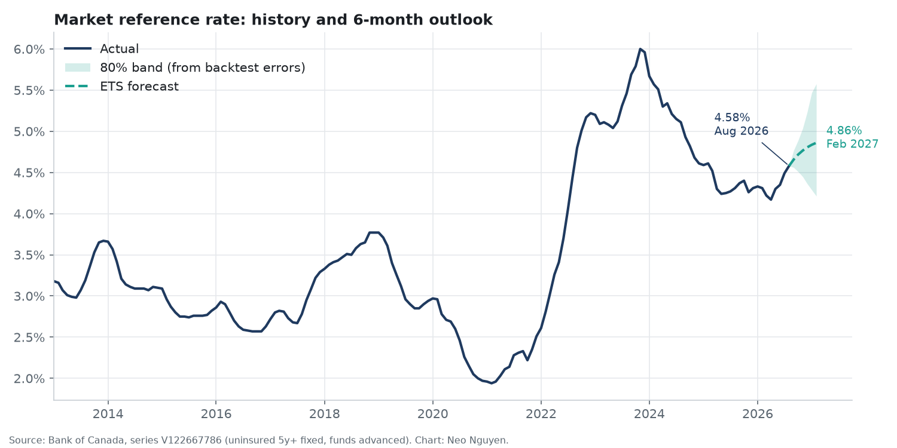
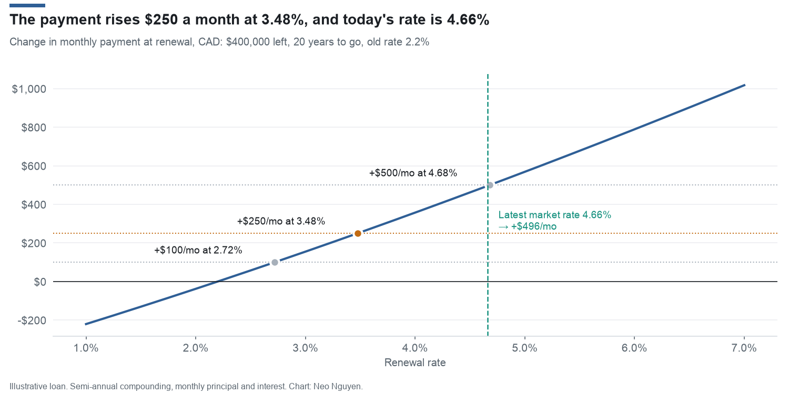
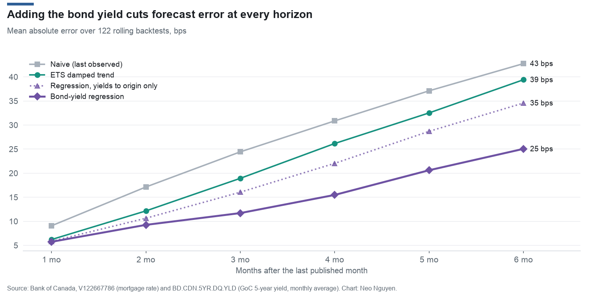
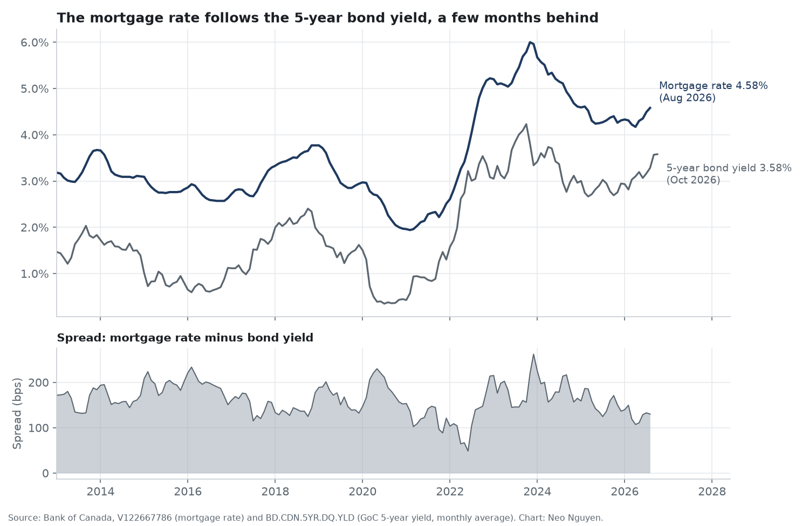
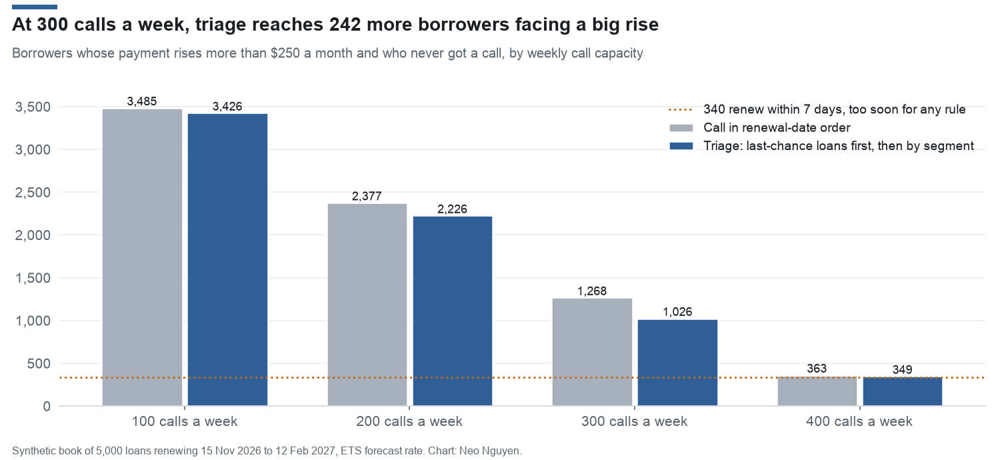
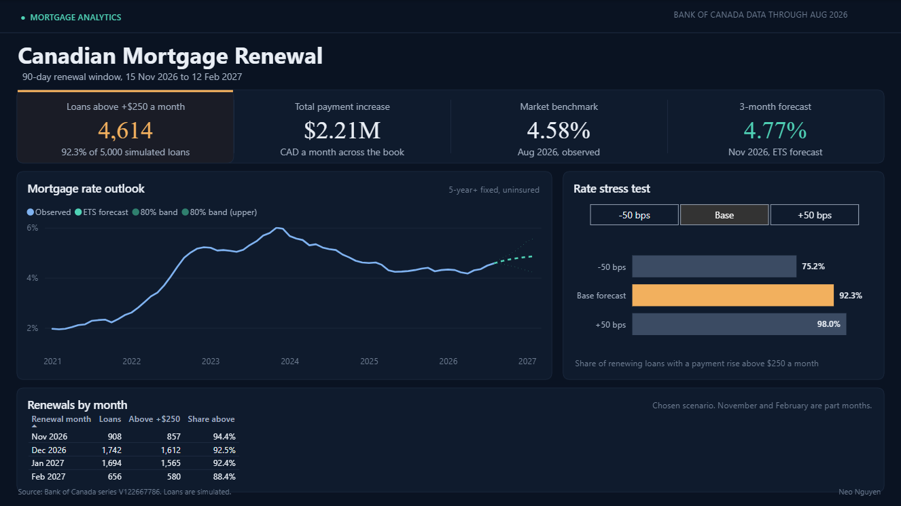
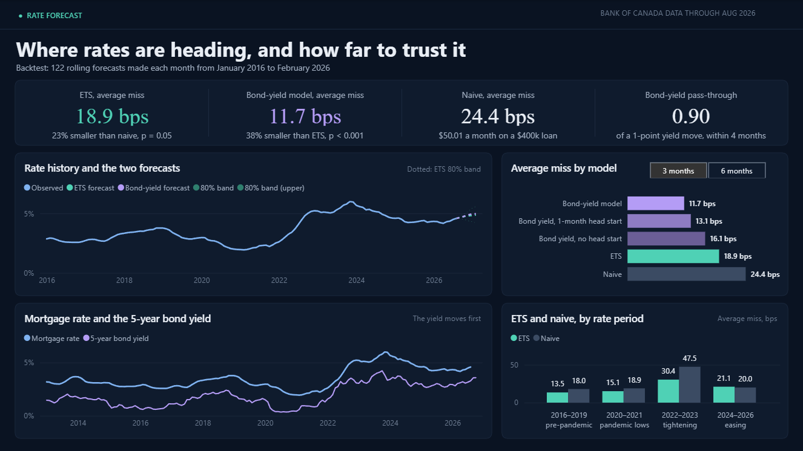
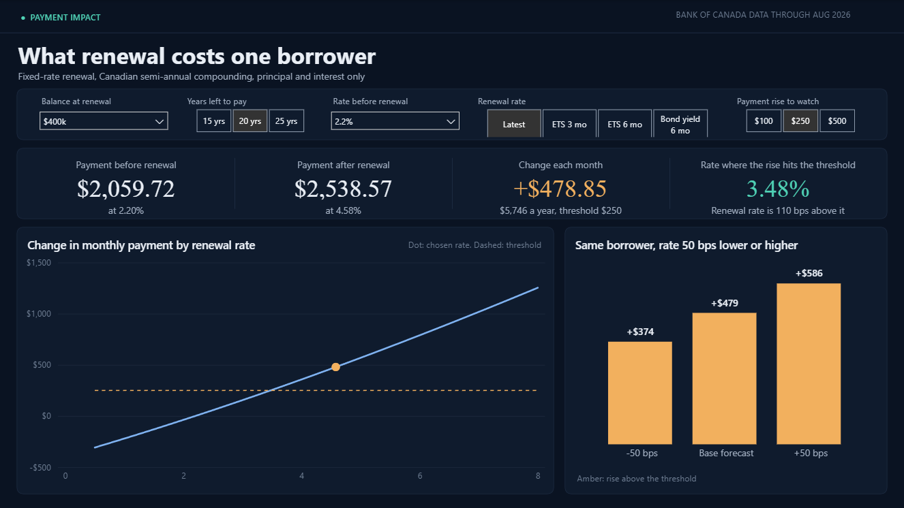
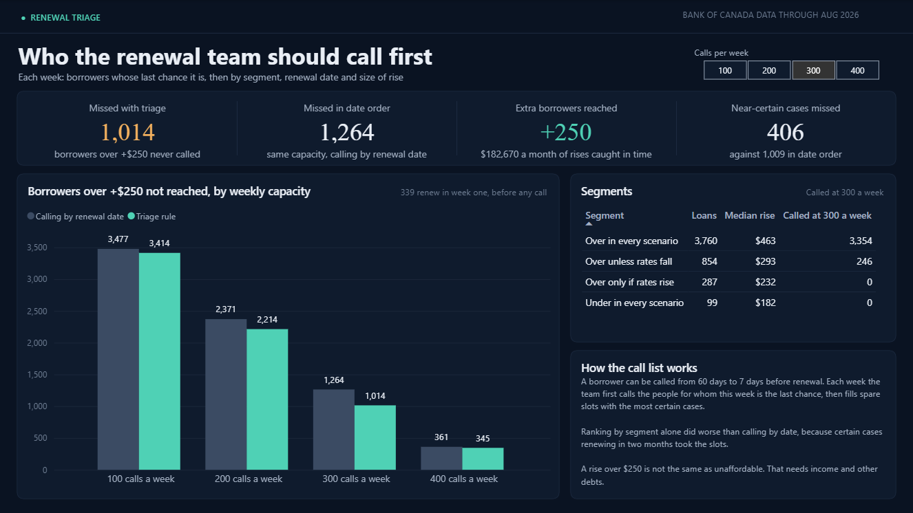

# Canadian Mortgage Renewal | Rate Forecast & Payment Impact

**Author:** Neo Nguyen · **Stack:** Python (pandas, statsmodels, matplotlib) · PostgreSQL · Power BI

A household that locked in a 5-year fixed rate of 2.2% in 2021 and renews today, with $400,000 left to pay, owes about $479 more every month.

This project forecasts where the 5-year fixed rate goes next, using Bank of Canada data, and works out what that means at renewal: for one borrower, and for a lender with 5,000 loans renewing in the next 90 days that has to decide whom to call first.

**[Read the full report with charts](reports/report.md)**



## Questions

1. How much does the monthly payment change at renewal under different rate scenarios?
2. What renewal rate pushes the payment up by $250 a month? In the Power BI report the threshold can be set to $100, $250 or $500.
3. If the rate forecast is wrong, how far off is the payment estimate, in CAD per month?

## Results

| Finding | Value |
|---|---|
| Latest market reference rate | 4.58% (August 2026) |
| ETS forecast, 3 and 6 months | 4.77% (Nov 2026) · 4.86% (Feb 2027) |
| 80% band from backtest errors | 4.45% to 5.04% at 3 months · 4.21% to 5.58% at 6 months |
| $400k, 20 years, 2.20% → 4.58% | $2,059.72 → $2,538.57 (+$478.85/month) |
| Rate where payment rises $250 | 3.48% (110 bps below today's rate) |
| Bond-yield pass-through | 0.90 of a 5-year yield move reaches the mortgage rate within 4 months (R² 0.63) |
| Bond-yield regression forecast | 4.82% (Nov 2026) · 4.97% (Feb 2027) |
| Synthetic 90-day book above +$250 | 4,614 of 5,000 loans (92%) at the forecast rate |
| Triage at 300 calls a week | Misses 1,014 borrowers facing +$250, against 1,264 when calling in renewal-date order |

**Backtest** (122 rolling origins, January 2016 to February 2026, same origins for every model)

| Model | Horizon | MAE (bps) | MAE (CAD/month) | Diebold–Mariano p |
|---|---|---|---|---|
| ETS damped trend | 3 months | 18.9 | $38.92 | 0.051 |
| Naive (last observed) | 3 months | 24.4 | $50.01 | |
| ETS damped trend | 6 months | 39.4 | $81.24 | 0.48 |
| Naive (last observed) | 6 months | 42.8 | $87.47 | |
| Bond-yield regression | 3 months | 11.7 | $23.82 | < 0.001 vs ETS |
| Bond-yield regression | 6 months | 25.0 | $51.39 | < 0.001 vs ETS |

ETS met the selection rule written before the backtest (beat the naive model at both horizons) and is used for the outlook. The 3-month gain is borderline significant and the 6-month gain is not. During the 2024 to 2026 easing period, the naive model was slightly more accurate (report section 5).

The bond-yield regression, added afterwards, beats both models at every horizon and in every rate period. It stays a challenger until it is tested on months published after this run (report section 7).

## Charts

| | |
|---|---|
|  |  |
| How the monthly payment moves with the renewal rate, and where it crosses +$100, +$250 and +$500 | Average forecast miss by model, 1 to 6 months ahead |
|  |  |
| The 5-year fixed rate follows the 5-year Government of Canada bond yield | Borrowers facing +$250 a month who are never called, by weekly call capacity |

All 17 charts are in the [full report](reports/report.md).

## Power BI report

A four-page report in a dark navy theme: an overview of the renewal book, forecast accuracy, payment impact for one borrower, and the triage call list. Slicers change the rate scenario, the forecast horizon, the loan and the weekly call capacity. It is saved as a Power BI Project (PBIP), so the model, the DAX and every visual are plain text in this repository. [How to open it and check the numbers](powerbi/README.md).

| | |
|---|---|
|  |  |
| Overview: the renewal book and where the rate is going | Rates & accuracy: how far off past forecasts were |
|  |  |
| Payment impact: what renewal costs one borrower | Renewal triage: who to call first with limited capacity |

## Data

Bank of Canada series [`V122667786`](https://www.bankofcanada.ca/valet/observations/V122667786/json): *Mortgages, funds advanced, residential mortgages, uninsured, total; fixed rate, 5 years and over*. Monthly, January 2013 to August 2026, in percent.

Bank of Canada series [`BD.CDN.5YR.DQ.YLD`](https://www.bankofcanada.ca/valet/observations/BD.CDN.5YR.DQ.YLD/json): Government of Canada 5-year benchmark bond yield, daily, averaged to complete months (through October 2026).

Every run saves the raw response and a metadata file with the URL, download time and latest month.

## Run the pipeline

You only need this to rebuild the numbers; opening the Power BI report doesn't. The script is for macOS or Linux (on Windows, use WSL). You need Python 3 (tested on 3.15) and PostgreSQL 14 or later running on `localhost:5432`. On a Mac the simplest way to get PostgreSQL is [Postgres.app](https://postgresapp.com): install it, open it, click Initialize. The pipeline creates the `mortgage_renewal` database and a `mortgage` schema by itself. To use another server, set `MORTGAGE_PG_DSN`, for example `host=localhost dbname=mortgage_renewal user=me password=...`.

```bash
./run_pipeline.sh
```

The script creates `.venv` on first run. Then it downloads and validates the data, runs the backtest and forecast, builds the uncertainty band and significance test, fits and backtests the bond-yield regression, simulates the portfolio, builds the triage call list, rebuilds the PostgreSQL schema and its 30 checks in one transaction, exports the CSVs the Power BI report reads, reconciles SQL against Python, redraws the charts, rebuilds the Power BI project and runs 44 tests.

## Project layout

```
src/
  config.py        settings, loan profile and the pre-registered model-selection rule
  fetch_data.py    download + validate the Bank of Canada series
  mortgage.py      payment formula and threshold-rate solver (exact and 1 bp grid)
  forecast.py      rolling-origin backtest and latest forecast
  intervals.py     80% band from backtest errors, Diebold–Mariano test
  regression.py    bond-yield regression: lag choice, backtest, latest forecast
  portfolio.py     synthetic 90-day renewal portfolio
  triage.py        call list: segments, priority rank, weekly call capacity
  db.py            PostgreSQL connection, CSV loading, query helper
  run_sql.py       builds the schema, loads the data, runs the checks, exports CSVs
  reconcile.py     SQL vs Python comparison
  charts.py        report figures
sql/
  01_tables.sql    schema, payment function, tables with primary and foreign keys
  02_views.sql     views for the charts and the Power BI CSVs
  03_checks.sql    key, join, gap and formula checks
powerbi/           Power BI project (MortgageRenewal.pbip) and build_pbip.py, which writes it
tests/             payment maths, threshold solver, balance, DM test, regression, triage, Power BI project
data/raw/          dated raw snapshot from the Bank of Canada
data/processed/    Python outputs read by SQL
data/powerbi/      CSVs the Power BI report reads
reports/           report.md and figures/
```

## Key assumptions

- Payments use Canadian semi-annual compounding, paid monthly, on the balance at renewal over the remaining amortization. Principal and interest only.
- The CAD error uses one illustrative loan: $400,000 balance and 20 years remaining.
- The Bank of Canada publishes this series about two to three months late. Horizons count from the last observed month, so the "3-month" forecast is close to a nowcast.
- The backtest uses the current data vintage, not the values first published.
- The market reference rate averages all funds advanced in the month: new mortgages, renewals and refinancing. It is not an individual offer.
- ±50 bps scenarios are rate-change scenarios. Forecast uncertainty is shown separately as the 80% band.
- The portfolio is synthetic (fixed seed). No real borrower data is used.

## Next

- Check the regression against ETS on September to November 2026 once they are published, and switch the headline forecast if it keeps winning.
- Rerun the triage at each backtest origin from 2018 to see whether a better rate forecast changes who gets called.

## Licence

The code is under the [MIT licence](LICENSE). The rate data comes from the Bank of Canada and is subject to the Bank's [terms of use](https://www.bankofcanada.ca/terms/). The loan portfolio is simulated.
