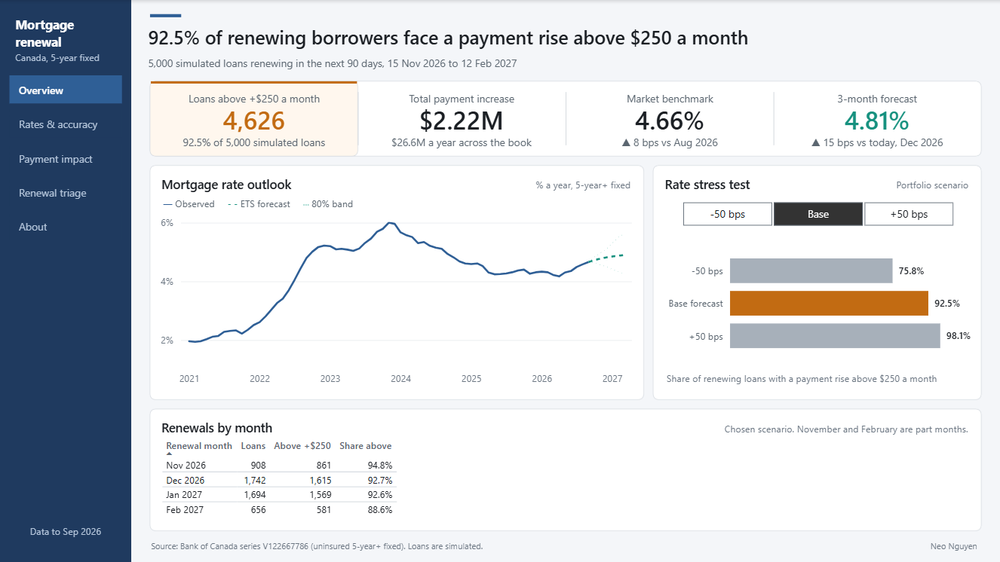
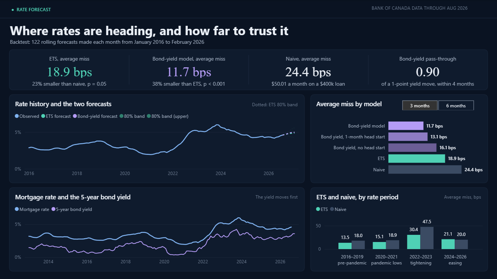
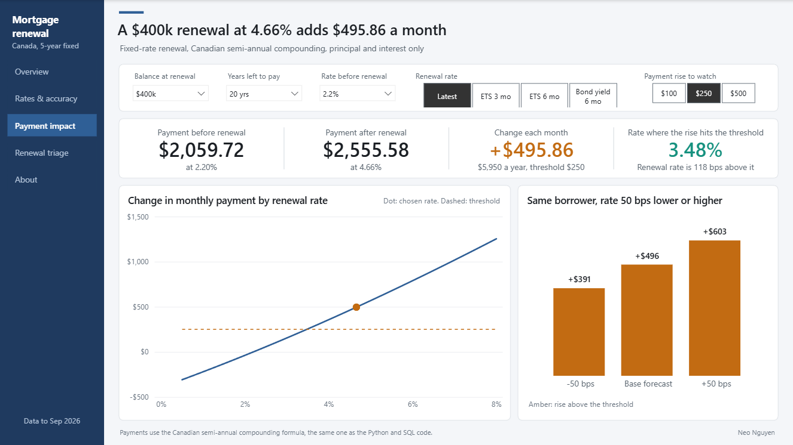
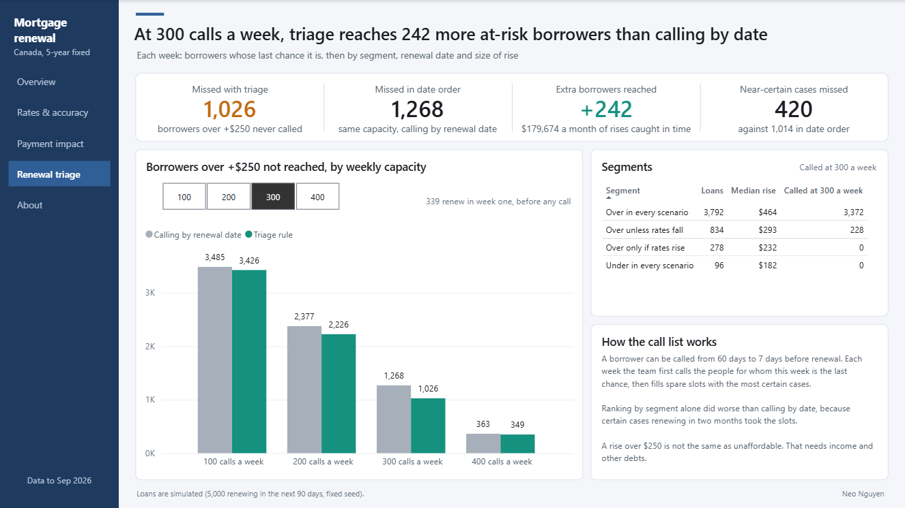

# Power BI report

A four-page Power BI report built on the CSVs the pipeline exports to `data/powerbi/`. It is saved as a Power BI Project (PBIP): plain-text files that Power BI Desktop opens like a `.pbix`, and that Git can diff.

## Pages

| Page | Question it answers | What you can change |
|---|---|---|
| Overview | How many renewing borrowers face a big jump, and where is the rate going? | Rate scenario (-50 bps, base, +50 bps) |
| Rates & accuracy | How far off were past forecasts, and does the bond yield help? | Horizon (3 or 6 months) |
| Payment impact | What does renewal cost one borrower? | Balance, years left, old rate, renewal rate, threshold |
| Renewal triage | Who should the team call first with limited capacity? | Calls per week (100 to 400) |

Screenshots from Power BI Desktop with the default slicer choices, so the numbers match the reference values below.

**Overview**



**Rates & accuracy**



**Payment impact**



**Renewal triage**



## Getting started

Requires a recent Power BI Desktop (2025 or later).

1. Clone the repository: `git clone https://github.com/neonguyen888/Canada-mortgage-renewal-forecast.git`
2. Open `powerbi/MortgageRenewal.pbip` and select Home > Refresh.
3. If Power BI asks how to connect to `raw.githubusercontent.com`, choose Anonymous.

The model reads the CSVs straight from this repository on GitHub, so the report works without running the pipeline. To read a local copy instead, go to Home > Transform data > Edit parameters and set `DataFolder` to the full path of `data\powerbi`.

## Data model

Each CSV becomes one table through Power Query. The queries read the files with an `en-US` culture, so `4.58` stays 4.58 on a machine set to a comma-decimal locale. `Calendar` links the rate tables by month.

The slicer tables (scenario, threshold, balance and so on) are small lookup tables with no relationships, and measures read the choice with `SELECTEDVALUE`. That keeps every bar visible when a slicer moves, and the chosen bar turns amber through a colour measure.

## Measures

All 71 measures live in the `measures_calc` table, grouped in five folders: Rates, Renewal book, Accuracy, Payment impact and Triage. The payment formula in DAX is the same Canadian semi-annual one used in `src/mortgage.py` and in the SQL function. The threshold rate is the lowest rate on a 1 bp grid where the payment rise reaches the threshold.

## Design

Navy canvas, amber for whatever needs attention, teal for the ETS forecast, light blue for observed data and lavender for the bond-yield model. The panels are drawn into a background image at twice the page size, and the visuals sit on top with transparent backgrounds. Text uses Segoe UI throughout, with the light weight for the large numbers, so it looks the same on any Windows machine.

## Reference values

With the default slicer choices, the cards should match the written report:

| Page | Card | Value |
|---|---|---|
| Overview | Loans above +$250 a month | 4,614 (92.3% of 5,000) |
| Overview | Total payment increase | $2.21M |
| Overview | Market benchmark / 3-month forecast | 4.58% / 4.77% |
| Rates & accuracy | ETS / bond-yield model / naive, average miss | 18.9 / 11.7 / 24.4 bps |
| Payment impact | Payment before / after / change | $2,059.72 / $2,538.57 / +$478.85 |
| Payment impact | Rate where the rise hits $250 | 3.48% |
| Renewal triage | Missed with triage / in date order (300 a week) | 1,014 / 1,264 |

`data/powerbi/threshold_reference.csv` lists more threshold rates the Payment impact page should reproduce.

## Rebuilding the project

`build_pbip.py` writes every file in this folder: the data model, all 111 visuals, the theme and the four background images. To change the layout, colours or a measure, edit the script and run:

```bash
.venv/bin/python powerbi/build_pbip.py
```

The pipeline runs it as its last step before the tests. Rebuilding overwrites changes made in Power BI Desktop, so pick one place to edit.

## Troubleshooting

- A visual shows an error after refresh: open Transform data and check that `DataFolder` points at the GitHub address or at a folder holding `vw_rate_outlook_band.csv` and the other exports.
- The project won't open: update Power BI Desktop. The files follow Microsoft's published PBIR and TMDL schemas, which older versions can't read.
- Slicers show as a vertical list: select the slicer and set Slicer settings > Style to Tile.
