# Canadian Mortgage Renewal: Rate Forecast and Payment Impact

**Author:** Neo Nguyen · **Data as of:** August 2026 (downloaded 14 November 2026) · **Tools:** Python, PostgreSQL, matplotlib, Power BI

## Summary

Many Canadian households that locked in a 5-year fixed rate during the pandemic lows are renewing now, at rates roughly two points higher. This report looks at three questions about that renewal:

1. How much does the monthly payment change under different rate scenarios?
2. What renewal rate pushes the payment up by $250 a month (or $100, or $500)?
3. If the rate forecast is wrong, how many dollars a month is the payment estimate off by?

For an illustrative loan with $400,000 left and 20 years to go, renewing from 2.20% at the latest market reference rate of 4.58% raises the payment from $2,059.72 to $2,538.57, which is $478.85 more each month. The payment crosses the $250 threshold at a renewal rate of about 3.48%, so today's market rate is already 110 bps past it.

A damped-trend ETS model forecasts the rate at 4.77% for November 2026 and 4.86% for February 2027. Over 122 rolling backtests it beat a naive "no change" forecast at both horizons: 18.9 vs 24.4 bps at 3 months and 39.4 vs 42.8 bps at 6 months. In payment terms that is $38.92 vs $50.01 a month, and $81.24 vs $87.47. The 3-month gain is close to statistically significant (p = 0.051). The 6-month gain is not (p = 0.48), and during the 2024 to 2026 easing period the naive model did slightly better.

A regression on the Government of Canada 5-year bond yield did better than both. About 0.90 of a move in the bond yield reaches the mortgage rate within four months, and because the yield is published two months before the mortgage figure, the regression already knows part of what is coming. Its backtest error was 11.7 bps at 3 months and 25.0 bps at 6 months, and the gain over ETS is statistically significant (p < 0.001). It expects a slightly steeper rise: 4.82% in November and 4.97% in February. ETS stays the headline forecast for now because I added the regression after the ETS results were known (section 7 explains).

On a synthetic book of 5,000 loans renewing in the next 90 days, 92% would see their payment rise by more than $250 a month at the forecast rate. A 50 bp lower rate still leaves 75% above the threshold. If the renewal team can call 300 borrowers a week, calling last-chance borrowers first and then the most certain cases reaches 250 more of those facing a $250 rise than working through renewal dates (section 11).

## Key terms

If you don't work with mortgages or forecasting every day, these are the words that come up most.

| Term | What it means here |
|---|---|
| bp / bps (basis point) | One hundredth of a percentage point. A move from 4.50% to 4.75% is 25 bps. |
| Market reference rate | The average 5-year fixed rate on uninsured mortgage money Canadian lenders advanced that month, across new loans, renewals and refinancing. |
| Renewal | When a 5-year fixed term ends, the borrower signs a new term at the current rate on whatever they still owe. |
| Amortization | The total time to pay the loan off, usually 25 or 30 years. A 5-year term is one slice of it. |
| Horizon | How far ahead a forecast looks. A 3-month horizon forecasts the rate three months after the latest data. |
| Backtest | Replaying the past: pretend it is an earlier month, forecast forward, and check against what actually happened. |
| Naive model | The simplest possible forecast: the rate stays where it is. Any real model has to beat it. |
| ETS (damped trend) | Exponential smoothing. It weights recent months most, follows the current direction, and slows that trend down the further out it goes. |
| MAE | Mean absolute error: the average size of a miss, ignoring whether it was too high or too low. Smaller is better. |
| Bias | The average miss with the sign kept. Negative means the model tended to forecast too low. |
| 80% band | The range the rate has fallen in 8 times out of 10 in past forecasts at the same horizon. |
| p-value | If two models were truly equally good, the chance of seeing a gap this big anyway. Below 0.05 is the usual bar for "probably a real difference". |
| Synthetic portfolio | Made-up loans with realistic numbers, used because real customer data isn't public. |
| Cohort | A group of loans that share something, here the month they renew or their balance range. |
| Triage | Deciding the order to deal with cases when there isn't time for all of them at once. |
| 5-year bond yield | The interest rate the Government of Canada pays to borrow for 5 years. Banks use it as the base cost when pricing 5-year fixed mortgages. |
| Spread | The gap between the mortgage rate and the bond yield, roughly what the lender adds on top of its cost. |
| Regression | A model that estimates how much one number moves when another one moves. Here: how much the mortgage rate moves after a move in the bond yield. |
| Lag | A delay. "Lag 2" means the yield change from two months earlier. |
| Pass-through | The share of a bond-yield move that ends up in the mortgage rate. 0.90 means a 1-point rise in the yield adds about 0.90 points to the mortgage rate. |
| R² | The share of the month-to-month ups and downs the model explains, from 0 to 1. 0.63 means about two thirds. |

## 1. Data

The rate used throughout is Bank of Canada series **V122667786**: the average interest rate on uninsured residential mortgages fixed for 5 years or more, for funds advanced in the month. The Bank counts new loans, renewals and refinancing as funds advanced, so renewing borrowers are already part of this average. The charts and the Power BI report call it the **market reference rate**. It is an average across lenders, so an individual borrower's offer can be higher or lower.

| Item | Value |
|---|---|
| Source | Bank of Canada Valet API, [V122667786](https://www.bankofcanada.ca/valet/observations/V122667786/json) |
| Coverage | January 2013 to August 2026, 164 months |
| Unit | Annual rate in percent; 1 bp = 0.01 percentage point |
| Checks on download | No missing months, no duplicate months, no blank values |
| Second series | GoC 5-year benchmark bond yield, [BD.CDN.5YR.DQ.YLD](https://www.bankofcanada.ca/valet/observations/BD.CDN.5YR.DQ.YLD/json), daily, averaged to months. Complete months only, through October 2026 |

Every run saves the raw JSON response with the download date, plus a metadata file recording the URL, the latest observed month and the unit convention.

## 2. How the rate has moved

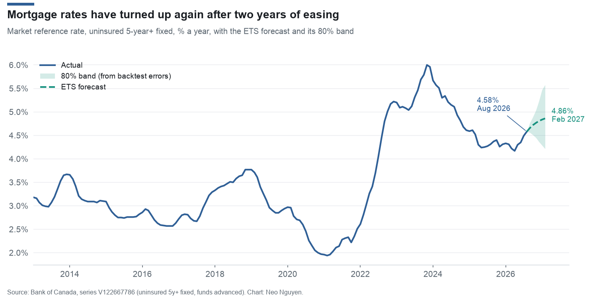

*Reading the chart: the solid blue line is what actually happened. The dashed teal line is the forecast, and the shaded area is the 80% band. The band gets wider because a forecast six months out is less reliable than one a month out.*

The rate spent most of 2013 to 2019 between 2.6% and 3.8%. It fell to a low of 1.94% in February 2021, then climbed to 6.00% by November 2023 as the Bank of Canada raised its policy rate. Since then it has eased to the low 4% range and turned up again in mid-2026, reaching 4.58% in August.

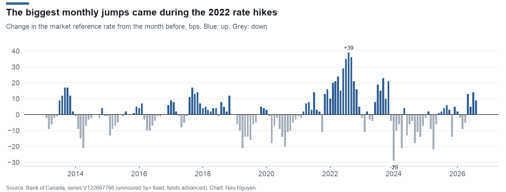

*Reading the chart: each bar is one month's change from the month before. Blue bars above zero are increases and grey bars below zero are decreases. 100 bps is one full percentage point.*

The largest monthly moves all came in mid-2022: +29 bps in June, +35 in July, +39 in August and +36 in September. Monthly changes are calculated in SQL with `LAG()`, and a change is only reported when the previous row is exactly the prior calendar month.

## 3. Forecasting approach

I compared two models.

- **Naive baseline.** Next month's rate equals the last observed rate. Rates move slowly, so this is hard to beat, and any model that can't beat it shouldn't be used.
- **ETS with a damped additive trend** (statsmodels). It follows the recent direction but lets the trend fade, so a rise isn't projected upward indefinitely.

**Rolling-origin backtest.** Starting in January 2016, I treated each month as "today", fitted both models on data up to that month only, and had them forecast 3 and 6 months ahead. That repeats for 122 origins, up to February 2026 (the last month with six months of actuals after it). Both models use exactly the same origins, and the training window expands, with at least 36 months of history at the first origin.

**Selection rule, set before running the backtest.** I would adopt ETS only if its MAE in bps beat the naive model at both horizons. Otherwise the naive model would ship.

**Turning rate error into dollars.** For every backtest forecast, I price the same loan ($400,000 balance, 20 years remaining) twice: once at the forecast rate and once at the rate actually observed for that target month. The CAD error is the difference between the two monthly payments.

## 4. Backtest results

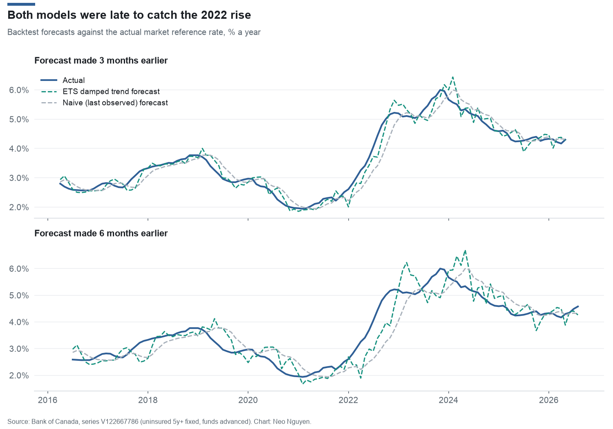

*Reading the chart: each point on a dashed line is a forecast made 3 months (top) or 6 months (bottom) before the date on the axis. The gap between a dashed line and the solid line is the miss. In 2022 both dashed lines trail below the solid line, because both models were late to catch the rise.*

| Model | Horizon | MAE (bps) | MAE (CAD/month) | Bias (bps) | Origins |
|---|---|---|---|---|---|
| ETS damped trend | 3 months | 18.9 | $38.92 | -0.4 | 122 |
| Naive (last observed) | 3 months | 24.4 | $50.01 | -3.3 | 122 |
| ETS damped trend | 6 months | 39.4 | $81.24 | -2.9 | 122 |
| Naive (last observed) | 6 months | 42.8 | $87.47 | -7.6 | 122 |

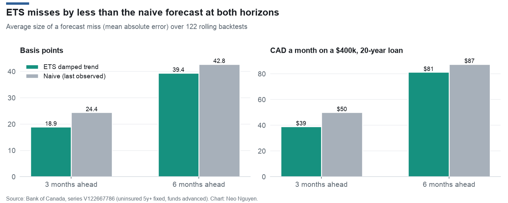

*Reading the chart: lower bars are better. The left panel measures the average miss in rate terms, the right panel in dollars a month on the example loan.*

ETS met the selection rule and is the model used for the outlook. The size of the win differs by horizon. At 3 months, ETS cuts the average error by about 23%, which is $11 a month on the illustrative loan. At 6 months the gain shrinks to about 8%, and both models miss by $80 to $90 a month, about a third of a $250 threshold.

**Is the difference real?** A Diebold-Mariano test compares the two models' absolute errors origin by origin. Forecasts from consecutive months overlap, so the test uses a Newey-West variance and the Harvey-Leybourne-Newbold small-sample correction.

| Horizon | Mean difference in absolute error | DM statistic | p-value |
|---|---|---|---|
| 3 months | -5.5 bps (ETS better) | -1.97 | 0.051 |
| 6 months | -3.4 bps (ETS better) | -0.71 | 0.48 |

In plain terms, a p-value of 0.051 means that if ETS and the naive model were really equally good, a gap as large as the one in this backtest would still turn up about 5% of the time by chance. At 0.48 it would turn up about half the time.

At 3 months the evidence for ETS is borderline. At 6 months the two models can't be told apart on this sample. ETS is a reasonable default, but the 6-month improvement is too small to rely on.

## 5. Where the models go wrong

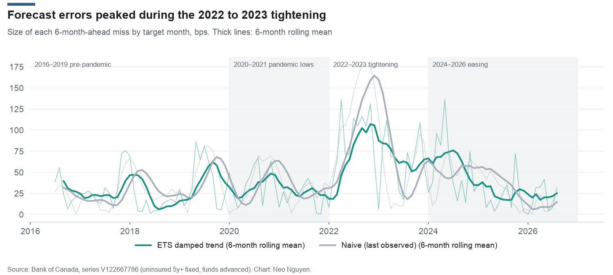

*Reading the chart: the thin lines are individual misses and the thick lines smooth them over six months. Higher means a bigger miss. The shaded bands mark the four rate periods in the table below.*

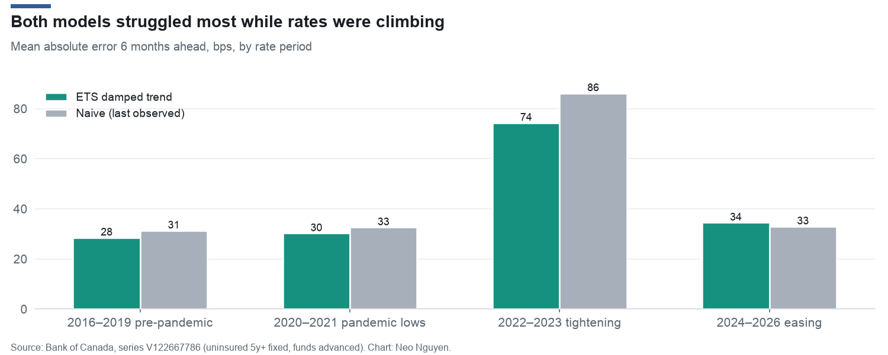

*Reading the chart: the same average miss as section 4, split by what the rate was doing at the time. Lower is better.*

| Period (target month) | ETS 3m | Naive 3m | ETS 6m | Naive 6m |
|---|---|---|---|---|
| 2016 to 2019, pre-pandemic | 13.5 | 18.0 | 28.5 | 31.3 |
| 2020 to 2021, pandemic lows | 15.1 | 18.9 | 30.2 | 32.6 |
| 2022 to 2023, tightening | 30.4 | 47.5 | 74.3 | 86.1 |
| 2024 to 2026, easing | 21.1 | 20.0 | 34.5 | 32.9 |

*MAE in bps.*

Errors more than doubled during the 2022 to 2023 tightening cycle. The naive model fell furthest behind there because it kept assuming no change while the rate rose by 30 to 40 bps a month. Its bias over that period was -44 bps at 3 months, meaning it consistently forecast too low. ETS picked up the trend and cut that bias to -15 bps.

The same trend-following works against ETS after a turning point. The backtest chart shows ETS overshooting the peak in late 2023 and briefly projecting a rebound in early 2024. Through the 2024 to 2026 easing period, when the rate moved sideways, the naive model was slightly more accurate at both horizons. In practice ETS helps most when the rate is clearly trending and adds little when it isn't.

## 6. The current outlook

The band around the forecast comes from the selected model's own backtest errors. For each horizon from 1 to 6 months, the 10th and 90th percentiles of "actual minus forecast" are added to today's forecast. This gives an 80% band based on how the model has actually performed on this series, without assuming errors are normally distributed.

| Target month | Horizon | Forecast | 80% band | Band width |
|---|---|---|---|---|
| Sep 2026 | 1 | 4.66% | 4.56% to 4.77% | 21 bps |
| Oct 2026 | 2 | 4.72% | 4.51% to 4.89% | 38 bps |
| Nov 2026 | 3 | 4.77% | 4.45% to 5.04% | 59 bps |
| Dec 2026 | 4 | 4.80% | 4.36% to 5.23% | 87 bps |
| Jan 2027 | 5 | 4.84% | 4.29% to 5.47% | 118 bps |
| Feb 2027 | 6 | 4.86% | 4.21% to 5.58% | 137 bps |

On the illustrative loan, the 3-month band covers payments from $2,511 to $2,636, a range of $125 a month. The 6-month band covers $2,461 to $2,755, a range of $293. The 6-month uncertainty alone is larger than the $250 threshold.

**Publication lag.** The Bank of Canada releases this series about two to three months after the month it describes. As of mid-November 2026 the latest month is August. The "3-month" forecast is for November 2026, which is close to a nowcast in calendar terms. The backtest uses the same convention at every origin, so the accuracy figures describe exactly this kind of forecast.

## 7. Adding the bond yield: a regression

Banks fund 5-year fixed mortgages roughly at the Government of Canada 5-year bond yield plus a margin. When the yield rises, mortgage rates follow, but with a delay. Borrowers can lock in a rate up to about 120 days before their money is advanced, and this series records the rate on the day the money goes out.

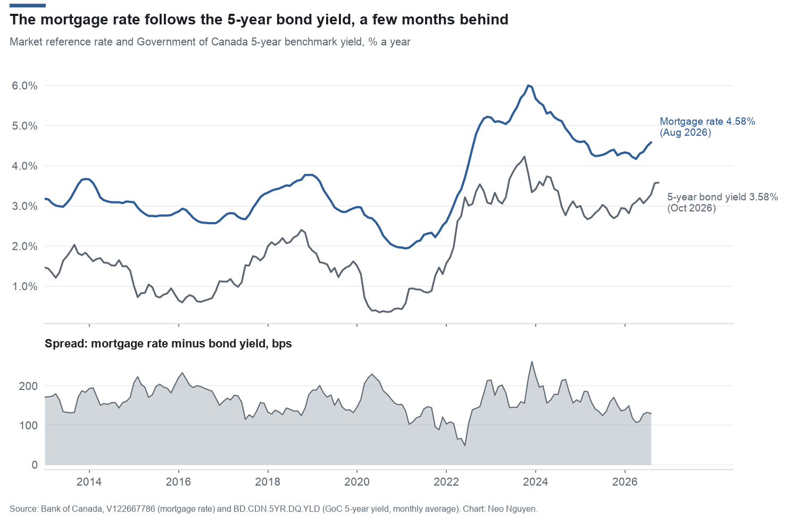

*Reading the chart: the blue line is the mortgage rate and the grey line is the 5-year bond yield. They move together, with the mortgage rate a few months behind. The bottom panel is the gap between them. The yield line runs two months further than the mortgage line because it is published sooner.*

**The model.** The regression explains each month's change in the mortgage rate using the change in the bond yield that month and in each of the previous few months:

```
change in mortgage rate = a + b0 × yield change this month
                            + b1 × yield change 1 month ago
                            + ...
                            + b4 × yield change 4 months ago
```

It uses monthly changes because both rates drift up and down over years. Two drifting series can look closely related even when neither drives the other, and working with changes avoids that trap.

**How many months back?** I chose the number of lags with BIC, a score that rewards a good fit but penalizes extra terms, using only 2013 to 2015 data, the period before the first backtest origin. BIC picked 4 months.

| Yield change from | Share passed through (b) | 95% range | Running total |
|---|---|---|---|
| Same month | 0.07 | 0.00 to 0.15 | 0.07 |
| 1 month earlier | 0.22 | 0.15 to 0.29 | 0.29 |
| 2 months earlier | 0.21 | 0.14 to 0.29 | 0.50 |
| 3 months earlier | 0.17 | 0.09 to 0.25 | 0.67 |
| 4 months earlier | 0.22 | 0.16 to 0.29 | 0.90 |

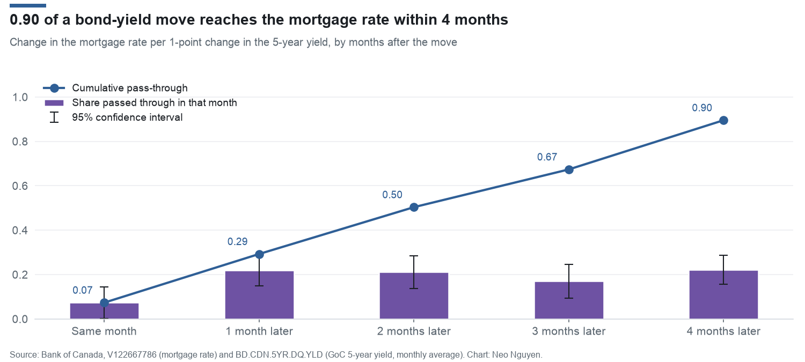

*Reading the chart: each purple bar is how much of a yield move shows up in the mortgage rate that many months later. The black whiskers are the 95% range. The blue line adds the bars up, so its last point is the total pass-through.*

Fitted on all 163 months (February 2013 to August 2026), the regression explains 63% of the monthly ups and downs (R² = 0.63). In total, 0.90 of a yield move reaches the mortgage rate within four months, with a standard error of 0.09. Very little arrives in the same month, which fits the rate-hold explanation. The errors of nearby months are related (Durbin-Watson 1.38), so the standard errors use the Newey-West correction, the same idea as in the Diebold-Mariano test.

**Backtest.** I ran the regression through the same 122 origins as the other two models, fitting it at each origin on data up to that month only. It then gets the bond yields for the next two months, because in practice those are already published when the mortgage figure comes out. After that I hold the yield flat.

The Bank's historical release dates aren't available, so I can't be sure two full months were always out in time. Two more versions, with only 1 month of yields past the origin or none, show how much the result depends on that.

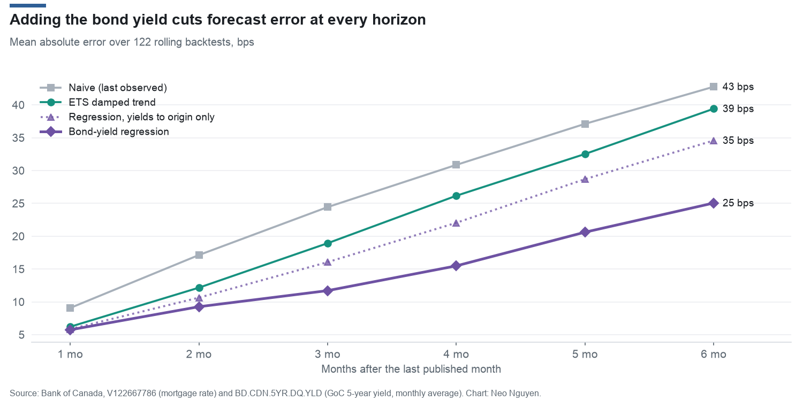

*Reading the chart: each line is one model's average miss at 1 to 6 months ahead. Lower is better. The solid purple line is the regression with the yields a forecaster would really have; the dotted purple line is the same regression without the two-month head start.*

| Model | 1 month | 2 months | 3 months | 6 months | 3 months (CAD) | 6 months (CAD) |
|---|---|---|---|---|---|---|
| Bond-yield regression | 5.7 | 9.3 | 11.7 | 25.0 | $23.82 | $51.39 |
| Regression, 1 month of extra yields | 5.7 | 9.2 | 13.1 | 29.7 | $26.64 | $60.95 |
| Regression, yields to origin only | 5.9 | 10.6 | 16.1 | 34.6 | $32.81 | $70.98 |
| ETS damped trend | 6.2 | 12.2 | 18.9 | 39.4 | $38.92 | $81.24 |
| Naive (last observed) | 9.1 | 17.1 | 24.4 | 42.8 | $50.01 | $87.47 |

*MAE in bps unless marked CAD.*

The regression cuts the 3-month error by 38% compared with ETS, which is $15 a month on the example loan. At 6 months the cut is 36%, or $30 a month. With 1 month of head start the 3-month error is 13.1 bps, and with none it is 16.1 bps, against 18.9 for ETS. Every version beats ETS at both horizons, so the conclusion holds whatever the real release lag was. The yield itself carries information, and each month of head start adds more.

| Comparison | Horizon | Mean difference | p-value |
|---|---|---|---|
| Regression vs ETS | 3 months | -7.2 bps | 0.0003 |
| Regression vs ETS | 6 months | -14.4 bps | < 0.0001 |
| Regression vs naive | 3 months | -12.7 bps | < 0.0001 |
| Regression vs naive | 6 months | -17.7 bps | 0.0004 |

Unlike ETS against naive in section 4, these differences are far too large to be chance. The regression also did best in every rate period. During the 2022 to 2023 tightening its 3-month error was 17.8 bps, against 30.4 for ETS. In the 2024 to 2026 easing period, where ETS lost to the naive model, the regression scored 9.9 bps against 21.1 for ETS and 20.0 for naive. It does well at turning points because the bond market turns first.

**Latest forecast.** The September and October forecasts use yields already published. From November on, the yield is held at its October level.

| Target month | Regression | ETS | Gap | Yield already known |
|---|---|---|---|---|
| Sep 2026 | 4.65% | 4.66% | -1 bp | yes |
| Oct 2026 | 4.72% | 4.72% | 0 bps | yes |
| Nov 2026 | 4.82% | 4.77% | +6 bps | no |
| Dec 2026 | 4.90% | 4.80% | +10 bps | no |
| Jan 2027 | 4.96% | 4.84% | +13 bps | no |
| Feb 2027 | 4.97% | 4.86% | +11 bps | no |

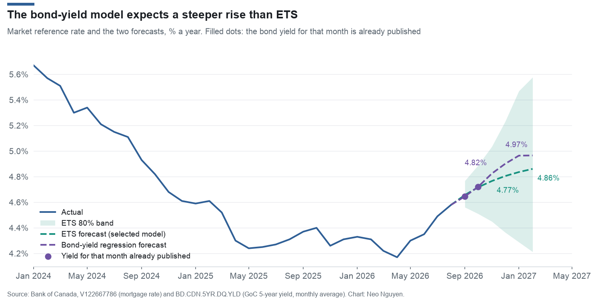

*Reading the chart: the two dashed lines are the two forecasts. The filled purple dots are months where the bond yield was already published. Both forecasts stay inside the ETS 80% band.*

The bond yield jumped from 3.28% in August to 3.57% in September. Only part of that rise has reached the mortgage rate so far, and the regression expects the rest over the next few months. On the example loan, the November rate of 4.82% means a payment of $2,589.77 ($530 more than at 2.2%), compared with $2,579.06 at the ETS rate. At the regression's rates, 4,711 loans in the 90-day book (94%) would rise by more than $250, against 4,614 (92%) at the ETS rates.

**Why ETS is still the headline forecast.** The selection rule in section 3 was written for ETS against the naive model before any results were in. I added the regression afterwards, once those results were known, so it hasn't passed the same clean test. The next few months of published data are that test. If it keeps beating ETS on September to November 2026, it should become the main forecast. Swapping it in now, after seeing that it wins, would be choosing the model by its result.

## 8. Payment impact for one borrower

Canadian fixed-rate mortgages compound semi-annually and are paid monthly. At renewal, the payment is recalculated on the balance still owed, over the remaining amortization, at the new rate:

```
monthly rate i = (1 + r/2)^(1/6) - 1
payment P = B · i / (1 - (1 + i)^(-n))
```

Here r is the quoted annual rate as a decimal (4.2% is 0.042), B is the balance still owed, and n is the number of monthly payments left (20 years is 240). The first line turns a rate that compounds twice a year into its monthly equivalent. Using r/12 instead, as US mortgages do, would slightly overstate the payment.

The reference case of $400,000, 20 years remaining, and 2.2% to 4.2% gives $2,059.72 to $2,458.57, an increase of $398.85 a month. Both the Python function and the SQL function are tested against these figures.

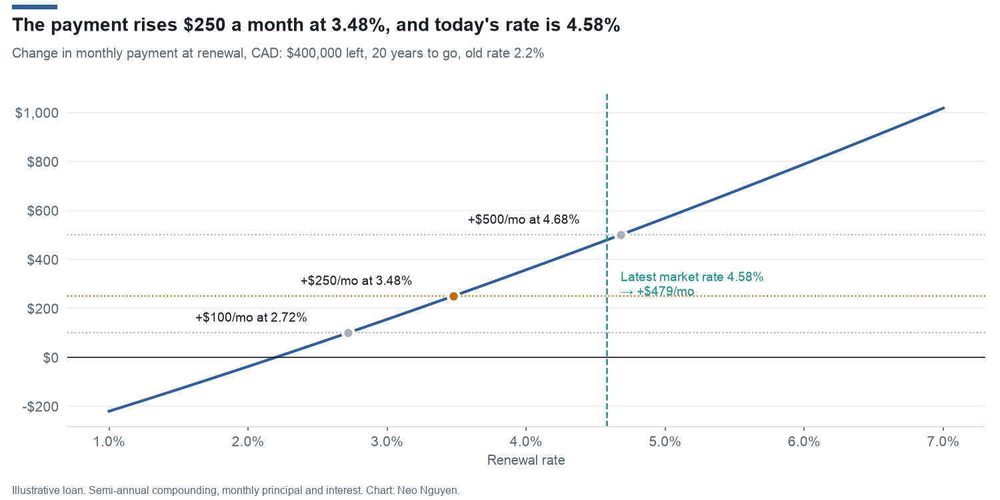

*Reading the chart: pick a dollar amount on the left, go across to the line, then down to the rate. Following $250 across, the line reaches it at 3.48%. The dashed vertical line is today's market rate, which sits well past that point.*

**Rate at payment threshold.** A higher rate always means a higher payment, so there is exactly one renewal rate at which the increase equals a given threshold. Python finds it by bisection. Power BI can't solve equations, so the report searches a 1 bp grid from 0.00% to 10.00% and takes the lowest rate whose increase meets the threshold. That grid answer is always between 0 and 1 bp above the exact rate.

| Threshold | Exact rate (Python) | Grid rate (SQL / Power BI) | Latest rate (4.58%) vs threshold rate |
|---|---|---|---|
| +$100/month | 2.7200% | 2.72% | 186 bps above |
| +$250/month | 3.4756% | 3.48% | 110 bps above |
| +$500/month | 4.6794% | 4.68% | 10 bps below |

The SQL grid matched the Python grid exactly on 12 test profiles, including a 0% old rate. If a threshold can't be reached inside 0% to 10%, the function returns no value and the Power BI card says so.

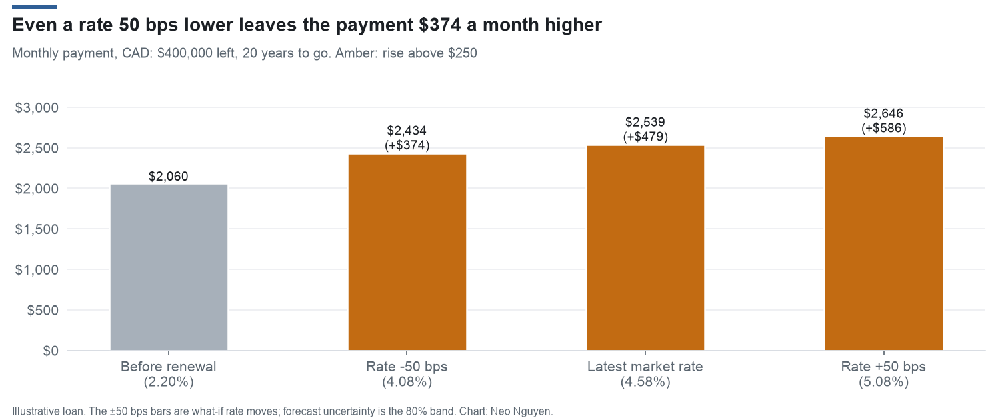

*Reading the chart: the grey bar is the payment before renewal. Each other bar is the payment at a different renewal rate, with the increase in brackets. Amber means the increase is above $250.*

| Scenario | Renewal rate | Payment | Change |
|---|---|---|---|
| Before renewal | 2.20% | $2,059.72 | |
| Rate -50 bps | 4.08% | $2,433.57 | +$373.85 |
| Latest market rate | 4.58% | $2,538.57 | +$478.85 |
| Rate +50 bps | 5.08% | $2,645.81 | +$586.09 |

The ±50 bp scenarios are what-if rate moves. They are named by the rate change to keep them separate from the forecast band in section 6, which measures forecast uncertainty.

## 9. Sensitivity to balance and rate

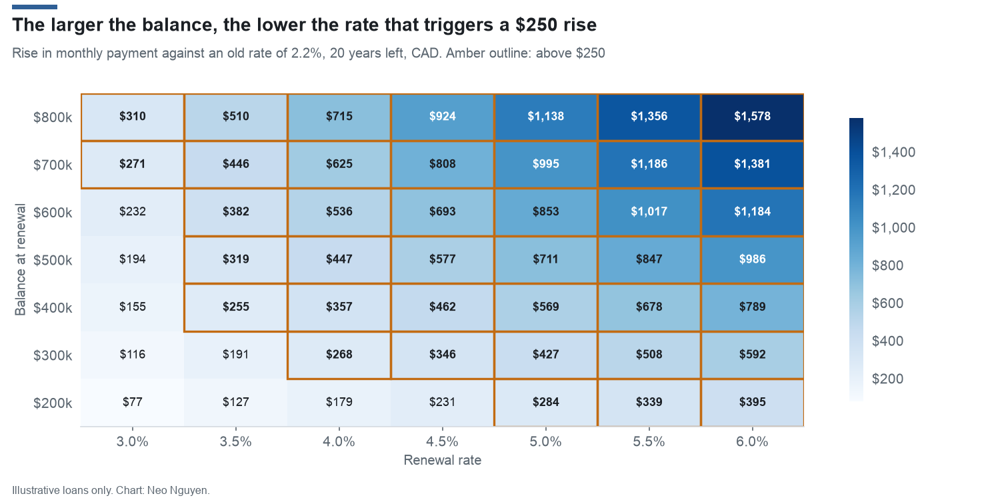

*Reading the chart: pick a row (how much is still owed) and a column (the new rate). The cell shows how much more the borrower pays each month compared with 2.2%. Darker blue is a bigger increase, and an amber border means it is above $250.*

The dollar increase grows with the balance. At a 4.5% renewal rate, a $200,000 balance rises by $231 a month and stays under the $250 threshold, while an $800,000 balance rises by $924. A borrower with $300,000 left crosses $250 somewhere between 3.5% and 4.0%; one with $700,000 left crosses it below 3.0%.

## 10. A 90-day renewal book

To move from one borrower to a lender's view, I generated a synthetic portfolio of 5,000 loans (fixed random seed). No real borrower data is used.

- Renewal dates are spread evenly over the 90 days after 14 November 2026, which runs to 12 February 2027. November and February are partial months.
- Each loan was signed 60 months before renewal at that month's market reference rate, plus a borrower spread drawn from a normal distribution with a 15 bp standard deviation.
- Original principal is log-normal with a median near $420,000, kept between $150,000 and $1.2 million. Three quarters of loans amortize over 25 years and a quarter over 30.
- The balance at renewal is the principal after 60 payments. The renewal rate is the ETS forecast for the renewal month plus the same borrower spread.

Because these loans were signed between November 2021 and February 2022, near the bottom of the rate cycle, their original rates average 2.56%. The forecast renewal rates average 4.82%.

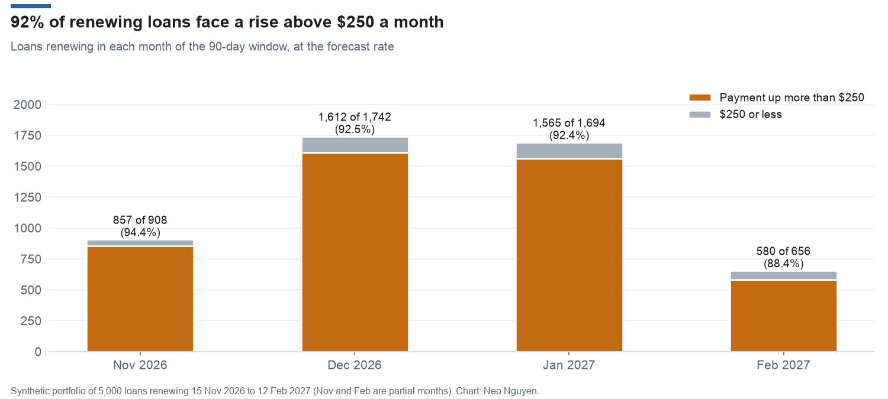

*Reading the chart: each bar is all the loans renewing that month. The amber part is loans whose payment rises by more than $250 and the grey part is the rest.*

| Renewal month | Loans | Above +$250 | Share | Rank by count | Rank by share |
|---|---|---|---|---|---|
| Nov 2026 (from the 15th) | 908 | 857 | 94.4% | 3 | 1 |
| Dec 2026 | 1,742 | 1,612 | 92.5% | 1 | 2 |
| Jan 2027 | 1,694 | 1,565 | 92.4% | 2 | 3 |
| Feb 2027 (to the 12th) | 656 | 580 | 88.4% | 4 | 4 |

December has the most loans over the threshold, so it carries the most work for a renewal or outreach team. November has the highest share because its loans were signed in November 2021 at 2.35%, the lowest starting rate in the window, so they face the biggest jump (about 2.4 points, against 2.0 for February). SQL ranks the cohorts both ways because November and February are only partly inside the window, so counts alone would undersell them.

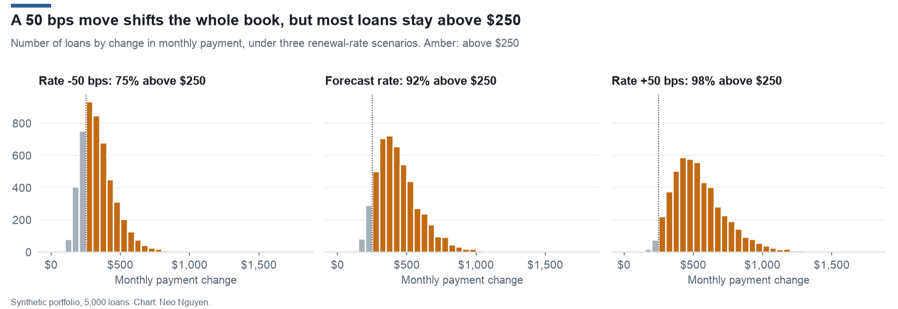

*Reading the chart: each bar counts loans whose payment rises by roughly that amount. Everything right of the dotted $250 line is amber. From left panel to right, the whole shape moves right as the renewal rate goes up.*

| Scenario | Above +$250 | Average change | Median change | Total extra per month |
|---|---|---|---|---|
| Rate -50 bps | 3,760 (75%) | $340 | $318 | $1.70M |
| Forecast rate | 4,614 (92%) | $442 | $413 | $2.21M |
| Rate +50 bps | 4,901 (98%) | $545 | $510 | $2.73M |

At the forecast rate every loan in the book pays at least $100 more a month, and 1,478 loans (30%) pay more than $500 more.

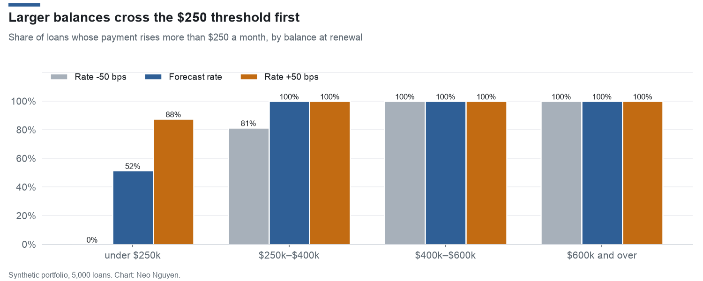

*Reading the chart: each group of three bars is one balance range. Bar height is the share of loans in that range whose payment rises more than $250, under each of the three rate scenarios.*

Balance explains most of the variation. At the forecast rate, every loan with more than $250,000 left crosses the $250 threshold, while about half of the loans under $250,000 do. A 50 bp drop in rates would bring the under-$250,000 group fully below the threshold, and the $250,000 to $400,000 group down to 81% above it. It would not change the picture for larger balances.

## 11. Extension: who should the team call first?

Section 10 shows how many borrowers face a big rise. A renewal team also has to decide the order, because it can only reach so many people a week. This section turns the three rate scenarios into a call list.

**Segments.** Each loan is priced at the forecast rate, 50 bps below it and 50 bps above it. A higher rate always means a higher payment, so every loan falls into one of four groups:

| Segment | Loans | Median rise at forecast | What it means for the team |
|---|---|---|---|
| Over in every scenario | 3,760 | $463 | Over $250 even if rates fall 50 bps. Call these. |
| Over unless rates fall | 854 | $293 | Close to the line. Watch the next rate quote. |
| Over only if rates rise | 287 | $232 | Have a call ready in case rates move up. |
| Under in every scenario | 99 | $182 | Normal renewal process. |

**Call rule.** A borrower can be called from 60 days before renewal until 7 days before, which leaves time to act on the call. Each week the team first calls the borrowers for whom this week is the last chance, then fills spare slots in order of segment, renewal date and size of the rise.

The last-chance step came out of testing. My first version ranked by segment alone, and it did worse than calling in renewal-date order: at 400 calls a week it missed 833 borrowers over the threshold, against 361. Near-certain borrowers renewing in two months took the slots, and likely borrowers renewing next week ran out of time.

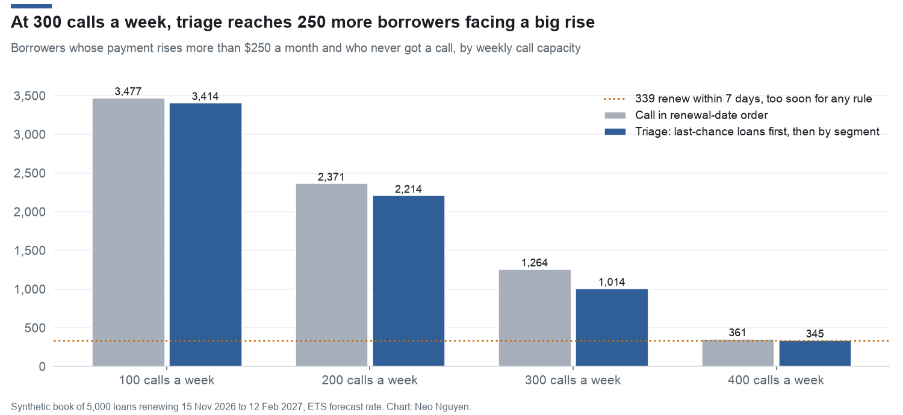

*Reading the chart: each pair of bars is one weekly call capacity. Lower is better: these are borrowers facing a rise over $250 who never got a call. The dotted line marks the 339 borrowers who renew in the first week, before any rule can reach them.*

| Calls a week | Missed, date order | Missed, triage | Near-certain missed, date order | Near-certain missed, triage |
|---|---|---|---|---|
| 100 | 3,477 | 3,414 | 2,787 | 2,560 |
| 200 | 2,371 | 2,214 | 1,902 | 1,360 |
| 300 | 1,264 | 1,014 | 1,009 | 406 |
| 400 | 361 | 345 | 304 | 290 |

*Borrowers over +$250 at the forecast rate who were not called at least 7 days before renewal. Near-certain means the first segment.*

At 300 calls a week the triage rule reaches 250 more borrowers facing a rise over $250 than date order does, and it misses 406 near-certain borrowers instead of 1,009. The payment rises of the borrowers it misses add up to $372,000 a month, against $554,000 with date order. At 400 calls a week both rules reach nearly everyone. The 290 near-certain borrowers still missed all renew in the first week.

**Why segments instead of one scenario.** A list built from the forecast scenario alone changes when the rate does. At 300 calls a week, 456 borrowers would drop off that list if rates fell 50 bps, and 190 if they rose 50 bps. The segments already account for all three scenarios, so the triage list stays the same.

The $250 figure measures how much the payment rises. Whether a borrower can afford it depends on income and other debts, which this synthetic book doesn't have. The list ranks borrowers by payment rise, so it can't say who is at risk of default.

## 12. Data checks and reconciliation

The whole PostgreSQL rebuild runs in one transaction. Primary and foreign keys reject duplicate rows and backtest months that don't exist while the data loads, and the pipeline rolls everything back if any of these checks fail:

- **Keys.** Months are unique in the actuals. Forecasts and backtest rows are unique on origin month, target month and model, because the same target month is forecast from several origins.
- **Joins.** Joining backtest forecasts to actuals keeps all 488 rows. Each of the 5,000 loans appears once per scenario (15,000 rows), and the monthly cohorts add back to 5,000.
- **Time series.** There are no gaps between the first and last month, and `LAG()` returns no value only for the first month.
- **Same test for both models.** Every origin and horizon has a forecast from both models.
- **Formulas.** The SQL payment function reproduces $2,059.72 and $2,458.57 to the cent.
- **Bond yield.** One row per month, no gaps, and a yield for every month that has a mortgage rate. Every month must have at least 15 trading days, so a cut-off download is caught.
- **Same test for all five models.** The model comparison has 30 rows (5 models × 6 horizons) for each of the same 122 origins, and its naive and ETS forecasts match the main backtest exactly.
- **Triage.** The four segments add up to 5,000 loans and match the scenario counts in section 10 (3,760 over at -50 bps, 4,614 over at the forecast). Priority ranks run from 1 to 5,000 with no gaps, no call is booked within 7 days of renewal, and more call capacity never means more borrowers missed.
- **SQL vs Python.** MAE in bps and CAD matches to within 0.01 for all four model and horizon pairs in the main backtest and all 30 in the model comparison. The triage segments match between Python and SQL. Threshold rates match on 12 profiles. The portfolio's total payment change and count above $250 match exactly.

In total there are 30 SQL checks and 45 unit tests. The tests cover the payment formula, the threshold solver (rate up, down, unchanged, 0% old rate, an exact hit on the threshold, and a solution outside the 0% to 10% search range), the balance calculation, the Diebold-Mariano helper, and the regression: it recovers known lag weights from fake data, uses known yields and then holds them flat, and picks its lag count without looking past 2015. The triage tests check the segment mapping, the rank order, the 7-day notice and 60-day lookahead, and that a last-chance borrower is called before a more certain one who can wait. The Power BI tests check that no measure shares a name with a table or column, that no two visuals on a page share a name, that every visual points at a field that exists, that every visual fits on its page, and that each slicer's default is one of its options.

## 13. Limitations

- The backtest uses today's version of the data. If the Bank revised past months, a forecaster at the time would have seen slightly different numbers, and real-time accuracy could be somewhat worse.
- The market reference rate mixes new loans, renewals and refinancing. A lender's own renewal offers can sit above or below that mix, and the series does not split them out.
- Payments are principal and interest only, with no property tax or insurance. The amortization is assumed to continue unchanged at renewal; in practice some borrowers extend it to soften the increase.
- The portfolio is simulated. Its shape (balances, amortization mix, renewal timing) is an assumption and doesn't describe any lender's book.
- The call list ranks by payment rise only. A real triage would add affordability (income, other debts) and each borrower's contact history.
- The regression assumes the bond yield stays flat after the last published month. A sharp move in yields after October 2026 would make its 4- to 6-month forecasts too low or too high.
- The link between yields and mortgage rates was steady over 2013 to 2026, but lenders can change their spread, as they did in 2020. The regression has no way to see that coming.

## 14. Reproduce

```bash
./run_pipeline.sh
```

It needs PostgreSQL running locally (see the README). This downloads the data, runs the backtest and forecast, builds the uncertainty band and the DM test, fits and backtests the bond-yield regression, simulates the portfolio, builds the triage call list, rebuilds the PostgreSQL schema and its checks, exports the CSVs the Power BI report reads, reconciles SQL against Python, redraws every chart in this report, rebuilds the Power BI project and runs the tests. Opening the Power BI report is covered in `powerbi/README.md`.
